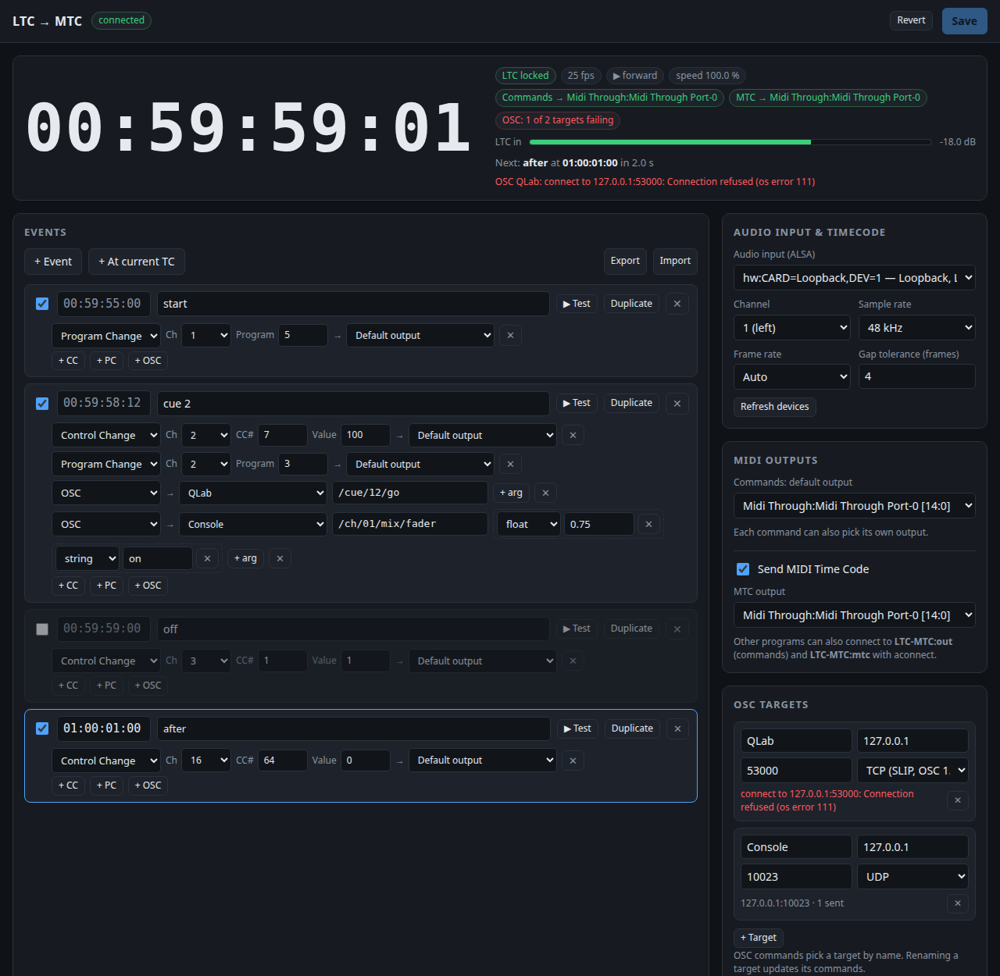

# ltc-mtc

An SMPTE LTC reader for the Raspberry Pi (3 and later) and other Linux machines:

- **reads LTC** from an ALSA audio input: 24, 25, 29.97 drop-frame and 30 fps, detected
  automatically or fixed. It also reads LTC played in reverse, at varispeed or with inverted
  polarity;
- **sends MIDI Time Code** to the output you choose, or none: quarter frames while the
  timecode runs, and a Full Frame message when it starts, after a locate, and in reverse;
- **fires MIDI events at given timecodes**. Each event is a time (HH:MM:SS:FF) with a list of
  Control Change (channel, controller, value) and Program Change (channel, program) commands.
  Each command goes to the default commands output or to an output of its own, so one event
  can drive several devices;
- has a **web interface** to choose the audio input and channel, the MIDI outputs (ALSA
  sequencer ports), the frame rate, and to edit, test, import and export the events.



## Hardware

The Pi has no audio input, so you need a USB audio interface (any class-compliant one) with
LTC on a line input. Levels from about -50 dBFS to full scale work. For MIDI out, use USB
MIDI interfaces (as many as needed), or any sequencer client on the Pi.

ltc-mtc is the sequencer client **LTC-MTC** with two ports, which `aconnect` and other
programs can also connect to: **LTC-MTC:out** carries the commands that use the default
output, and **LTC-MTC:mtc** carries the MIDI Time Code.

## Install on the Pi

Raspberry Pi OS (32 or 64 bit), Bookworm or later:

```sh
curl https://sh.rustup.rs -sSf | sh     # once; log in again afterwards
git clone <this repo> ltc-mtc && cd ltc-mtc
deploy/install.sh
```

`install.sh` installs `libasound2-dev` if needed, builds (a few minutes on a Pi 3), installs
`/usr/local/bin/ltc-mtc` and the systemd service `ltc-mtc`, and starts it. Then open
`http://<pi>:8088/`. If another program uses port 8088, choose another one with
`deploy/install.sh --port N` (the script checks that the port is free).

The service runs with real-time priority for the audio and MIDI threads, under a dynamic user
in the `audio` group, and keeps its settings in `/var/lib/ltc-mtc/config.json`.

To show the interface on a screen attached to the Pi, run
`chromium-browser --kiosk http://localhost:8088/`.

## Using it

1. **Audio input & timecode**: choose the audio input (prefer the card's `plughw:` entry;
   `dsnoop:` shares the input with other programs) and the channel carrying LTC.
2. **MIDI outputs**: choose the default output for the commands. Switch MIDI Time Code on or
   off and choose its output, which may be another port. Press **Save**. The level meter
   and the `LTC locked` badge show that the signal arrives, and the badges show where the
   commands and the MTC go.
3. **Events**: use **+ Event**, or **+ At current TC** while the timecode runs. Set the time
   and add commands with **+ CC** and **+ PC**. Each command's **→** menu picks its output:
   *Default output* or a specific port. **▶ Test** sends an event's commands immediately.
   **Save** (or Ctrl+S) stores the list and makes it active.
4. **Fired** lists what was sent, with the wall clock time and the timecode.

Outputs are stored by port name ("Client:Port"), so a USB MIDI interface is found again
after it is unplugged, plugged in elsewhere or renumbered. Missing outputs are shown in red at
the top of the page.

Channels are 1 to 16. Controller, value and program numbers are 0 to 127. Many devices show
programs as 1 to 128, so program 0 there is "1".

### When events fire

- Events fire when the timecode **crosses** their time going forward, on the exact frame.
  Frames the reader missed (a dropout of up to *Gap tolerance* frames, 4 by default) do not
  lose an event.
- Stopping and continuing does not repeat events. Rolling back over an event (in reverse, or
  with a locate) and playing forward over it again fires it again.
- After a **locate** or a start, events in the last *Gap tolerance* frames before the first
  frame read also fire. This way a cue at the very start of a roll is not lost while the
  reader locks.
- Nothing fires in reverse.

### MTC

The MTC follows the LTC with about one audio period of delay (5 ms). The frame clock is
smoothed against the jitter of the audio blocks. A missed LTC frame, a jump or a start sends a
Full Frame message and restarts the quarter-frame cycle. In reverse, a Full Frame message is
sent for every frame. When the LTC stops, the quarter frames stop.

## Command line

```
ltc-mtc [--config FILE] [--listen ADDR:PORT]     run (default 0.0.0.0:8088, ~/.config/ltc-mtc/config.json)
ltc-mtc devices                                  list audio inputs and MIDI outputs
ltc-mtc gen FILE.wav [--start TC] [--fps 25] [--seconds 30] [--rate 48000] [--level -10]
                                                 write an LTC test signal
ltc-mtc decode FILE.wav                          print the timecode in a WAV file
```

The web page uses a small JSON API, which other tools can use too:

| Request | |
|---|---|
| `GET /api/status` | timecode, lock, frame rate, speed, level, MIDI and MTC ports, next event, fired log |
| `GET /api/devices` | audio inputs and MIDI outputs |
| `GET /api/config`, `PUT /api/config` | settings and events (validated and saved) |
| `POST /api/fire` | `{"id": "e3"}` fires a saved event; `{"commands": [...]}` sends commands |

An event in the config:

```json
{ "id": "e2", "name": "cue 2", "time": "00:59:58:12", "enabled": true,
  "commands": [ { "type": "cc", "channel": 2, "controller": 7, "value": 100 },
                { "type": "pc", "channel": 2, "program": 3, "output": "UM-ONE:UM-ONE MIDI 1" } ] }
```

A command without `output` uses `midi_output`, the default commands output. MTC uses
`mtc_enabled` and `mtc_output`.

## Testing without hardware

`scripts/loopback-test.sh` loads `snd-aloop`, plays a generated LTC file into the loopback,
runs ltc-mtc on it with Midi Through as the output, and shows what `aseqdump` received.
`scripts/routing-test.sh` checks the routing: default commands, a command with its own
output, and MTC on its own port, with MTC on and off.
`scripts/ui-demo.sh start|stop` keeps LTC running for a look at the web interface on port
8088 (`LTC_DEMO_PORT` to change it).

## Building

```sh
sudo apt install libasound2-dev pkg-config
cargo build --release
cargo test
```

Building on the Pi itself is the simplest way to get a binary that matches its OS (armhf or
arm64). The program uses about 0.3 % of a Pi 5 core and 4 MB of memory.
